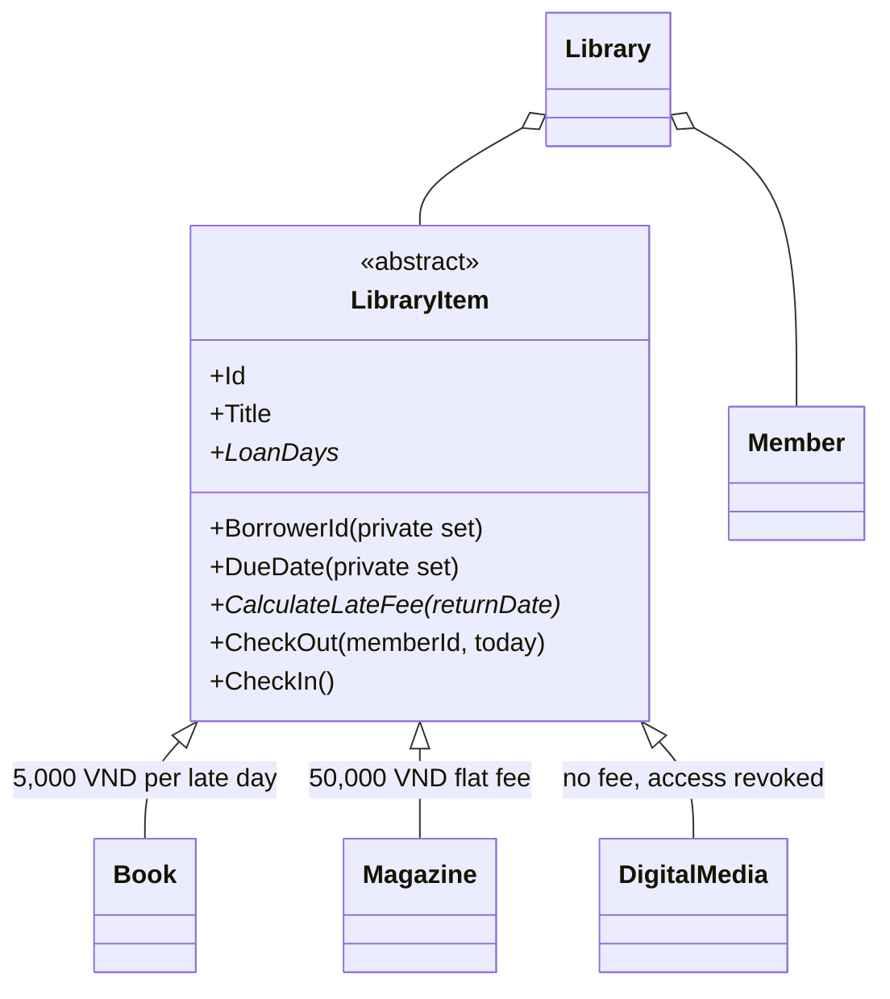

# SmartLibrary

WinForms app (C#, .NET 10) for librarians: search items, check items out and in, manage members.

## Run

Open `SmartLibrary.sln` in Visual Studio and press **F5**. Sign in with a demo account:

| Staff ID | Password | Role | Can add/remove members, reset data |
|---|---|---|---|
| A001 | admin123 | Admin | Yes |
| L001 | librarian123 | Librarian | No |

Data is saved automatically to `library-data.json` next to the exe after every change.
Admins can restore the demo data with **Reset to Demo Data** on the Dashboard.

## Tests

Test → Run All Tests in Visual Studio, or `dotnet test`. The xUnit project `SmartLibrary.Tests` covers
late-fee rules, lending rules, payments, factory, reports, login/permissions and JSON save/load.

## OOP design

- **Abstraction / inheritance:** `LibraryItem` is abstract; `Book`, `Magazine`, `DigitalMedia` extend it.
- **Polymorphism:** `Library.CheckIn` calls `item.CalculateLateFee(...)` without knowing the item type.
- **Encapsulation:** loan state and fines have private setters and only change through methods that validate (`CheckOut`, `CheckIn`, `AddFine`, `PayFine`).
- **Second hierarchy:** abstract `Person` → `Member` and abstract `Staff` → `Librarian`, `Admin`, each with its own `GenerateReport()`.
- **Role permissions by polymorphism:** the UI asks `user.CanManageMembers` instead of checking role names.
- **Security:** passwords stored as salted PBKDF2-SHA256 hashes; 3 failed sign-ins close the app.
- **Persistence:** `LibraryStorage` flattens objects to JSON records and rebuilds them through `ItemFactory` and the normal `Library` methods, so loaded data is validated too.
- **Interface:** `IReportable` is shared by `LibraryItem` and `Person`; the Dashboard lists every object's report through one `IReportable` loop.
- **Factory pattern:** `ItemFactory.Create(type, id, title)` builds the right subclass for the Add Item form.

## Demo tips

- B002 is borrowed 20 days ago at startup, so it shows as overdue (red row, Dashboard count).
- Check Out / In tab: set **Borrow date** in the past or **Return date** in the future to show each late-fee rule.
