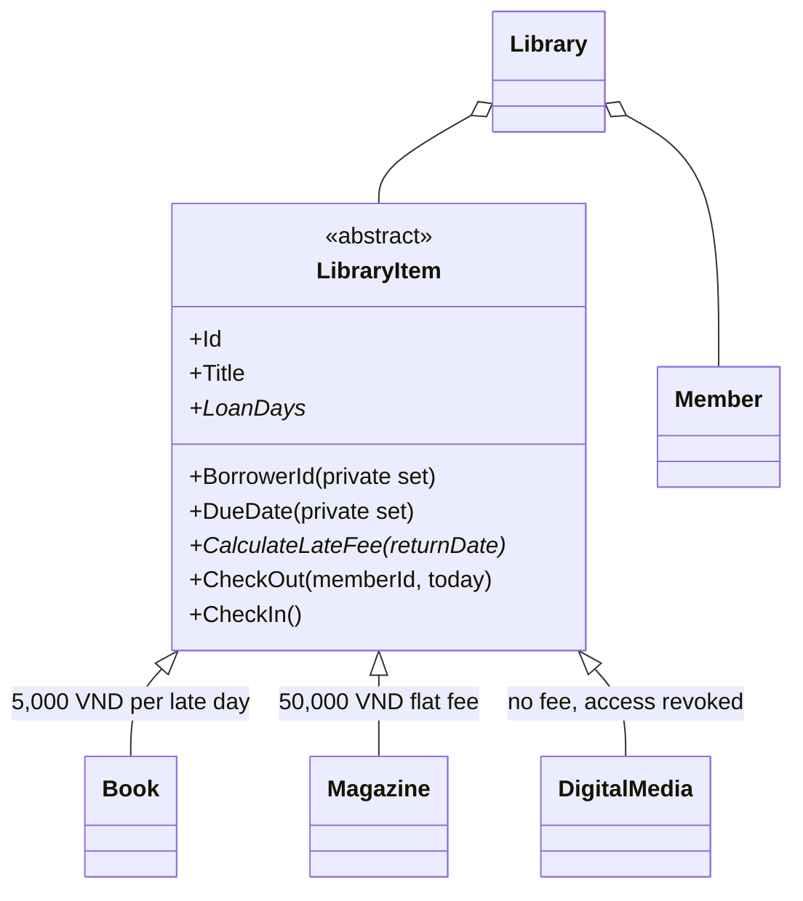

# SmartLibrary

WinForms app (C#, .NET 10) for librarians: search items, check items out and in, manage members.

## Run

Open `SmartLibrary.csproj` in Visual Studio and press **F5**.
In Debug builds, `SelfCheck.Run()` checks the lending rules at startup.

## OOP design

- **Abstraction / inheritance:** `LibraryItem` is abstract; `Book`, `Magazine`, `DigitalMedia` extend it.
- **Polymorphism:** `Library.CheckIn` calls `item.CalculateLateFee(...)` without knowing the item type.
- **Encapsulation:** loan state and fines have private setters and only change through methods that validate.

Data is kept in memory and reset on every start.
