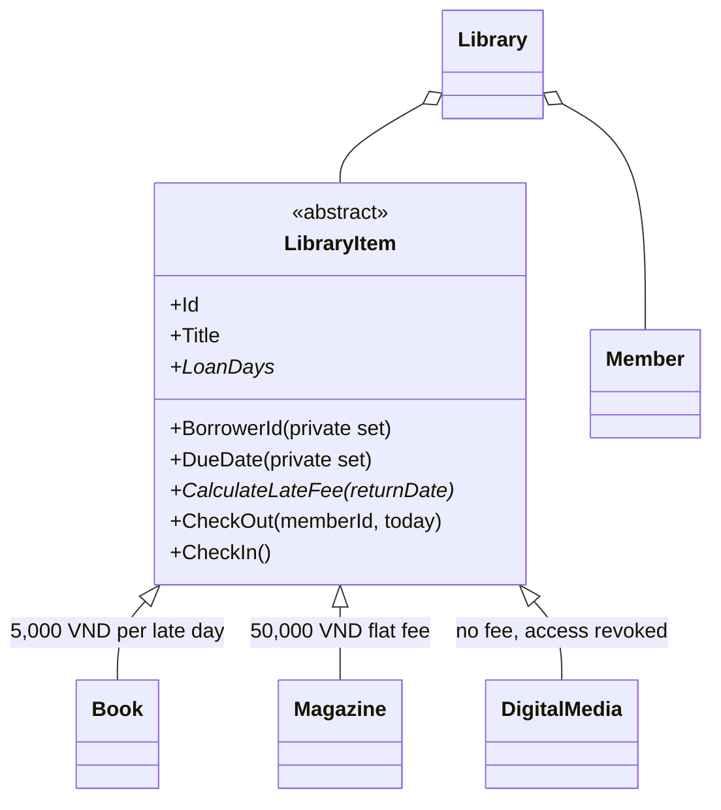

# SmartLibrary

WinForms app (C#, .NET 10) for librarians: search items, check items out and in, manage members.

## Run

Open `SmartLibrary.csproj` in Visual Studio and press **F5**.
In Debug builds, `SelfCheck.Run()` checks the lending rules at startup.

## OOP design

- **Abstraction / inheritance:** `LibraryItem` is abstract; `Book`, `Magazine`, `DigitalMedia` extend it.
- **Polymorphism:** `Library.CheckIn` calls `item.CalculateLateFee(...)` without knowing the item type.
- **Encapsulation:** loan state and fines have private setters and only change through methods that validate (`CheckOut`, `CheckIn`, `AddFine`, `PayFine`).
- **Second hierarchy:** abstract `Person` → `Member`, `Librarian`, each with its own `GenerateReport()`.
- **Interface:** `IReportable` is shared by `LibraryItem` and `Person`; the Dashboard lists every object's report through one `IReportable` loop.
- **Factory pattern:** `ItemFactory.Create(type, id, title)` builds the right subclass for the Add Item form.

## Demo tips

- B002 is borrowed 20 days ago at startup, so it shows as overdue (red row, Dashboard count).
- Check Out / In tab: set **Borrow date** in the past or **Return date** in the future to show each late-fee rule.

Data is kept in memory and reset on every start.
